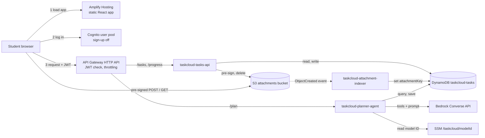
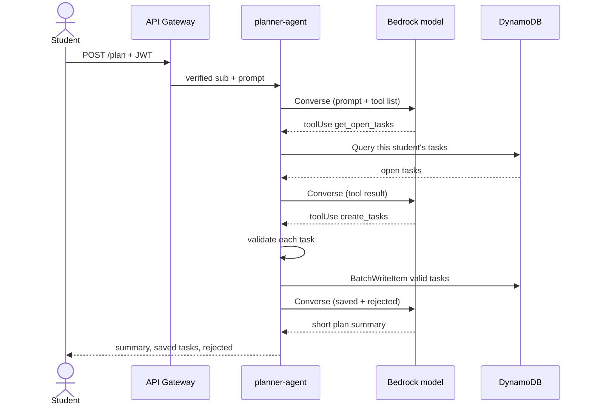

# TaskCloud architecture

This file is the source of truth for the design. To change it, add an entry to `docs/DECISIONS.md` and update this file and `docs/IAM_ACL.md` in the same commit. The original plan is in `docs/TaskCloud_Cloud_Architecture.pdf`.

## Architecture flowchart

## Planner sequence

## Stack table

Deploy in order 0 to 4. Delete in reverse. Exports are named `<stack>-<Output>`.

| # | Stack | Template | Owner | Contents | Exports |
|---|---|---|---|---|---|
| 0 | `taskcloud-foundation` | `infra/0_foundation.yaml` | Aadesh | Deploy role `taskcloud-cfn-role`; artifact bucket `taskcloud-artifacts-<account>-<region>`; CloudTrail trail and its bucket; budget with email alert | `CfnRoleArn`, `ArtifactBucket` |
| 1 | `taskcloud-data` | `infra/1_data.yaml` | Sanchit | DynamoDB table; Cognito user pool and app client | `TableName`, `TableArn`, `UserPoolId`, `UserPoolArn`, `UserPoolClientId` |
| 2 | `taskcloud-api` | `infra/2_api.yaml` | Aatyush | HTTP API, JWT authorizer, stage; tasks-api and attachment-indexer Lambdas with roles and log groups; attachments bucket and event notification | `ApiId`, `ApiEndpoint`, `AuthorizerId`, `AttachmentsBucket` |
| 3 | `taskcloud-agent` | `infra/3_agent.yaml` | Aadesh | Planner Lambda, role, log group; `POST /plan` route, integration and permission on the imported API; SSM parameter `/taskcloud/modelId` | `PlannerFunctionArn` |
| 4 | `taskcloud-frontend` | `infra/4_frontend.yaml` | Krushna | Amplify app (Platform WEB, no repository, SPA rewrite) and branch `main` with auto-build off | `AmplifyAppId`, `AmplifyDefaultDomain`, `SiteUrl` |

## Services

- **Frontend:** static React + Vite single-page app on Amplify Hosting, deployed manually without a Git connection (D-008).
- **Auth:** Cognito user pool with `AllowAdminCreateUserOnly: true`. The username is the email. The app client has no secret and allows SRP and refresh-token auth. The frontend uses aws-amplify v6 and handles the "new password required" step.
- **API:** HTTP API with a JWT authorizer on every route. Issuer `https://cognito-idp.<region>.amazonaws.com/<userPoolId>`, audience the app client ID. CORS allows all origins (D-007), the `authorization` and `content-type` headers, and GET, POST, PATCH, DELETE and OPTIONS. There are no OPTIONS routes. `$default` stage with auto-deploy and a default throttle of burst 10, rate 5. Integration timeout 29000 ms.
- **Lambda:** python3.13, fixed names `taskcloud-tasks-api`, `taskcloud-attachment-indexer`, `taskcloud-planner-agent`.
- **Data:** DynamoDB table `taskcloud-tasks`, on-demand, partition key `userId` (S), sort key `taskId` (S).
- **Files:** S3 bucket `taskcloud-attachments-<account>-<region>`, Block Public Access on, BucketOwnerEnforced (ACLs disabled), SSE-S3, CORS for browser POST and GET.
- **AI:** Bedrock Converse API with tool use. The model ID comes from `/taskcloud/modelId` and is cached per container (D-006, D-013).
- **Platform:** CloudFormation, IAM, CloudTrail, CloudWatch Logs (log groups defined in templates with 7-day retention) and AWS Budgets.
- **Not used:** EC2, VPC, load balancers, RDS, SNS, SQS or containers.

## Data model

| Attribute | Type | Rules |
|---|---|---|
| `userId` | String, partition key | Cognito `sub` from the verified JWT. Never from the request body or the model. |
| `taskId` | String, sort key | uuid4 |
| `title` | String | 1 to 120 characters after trimming |
| `dueDate` | String | `YYYY-MM-DD` |
| `priority` | String | `low`, `medium` or `high` |
| `status` | String | `todo` or `done` |
| `estMinutes` | Number | Integer from 5 to 480 |
| `source` | String | `manual` or `agent` |
| `attachmentKey` | String, optional | S3 key, set by the indexer |
| `createdAt` | String | UTC ISO 8601 |
| `completedAt` | String, optional | Set when status becomes `done`, removed when it returns to `todo` |

## API routes

All routes use payload format 2.0 and require a valid JWT.

| Route | Lambda | Behaviour | Success |
|---|---|---|---|
| `GET /tasks` | tasks-api | Strongly consistent Query, paginated internally up to 500 items. Returns `{"tasks": [...], "truncated": bool}`. | 200 |
| `POST /tasks` | tasks-api | Validates and creates a task with `source: manual`. Requires `title` and `dueDate`; `priority` defaults to `medium`, `estMinutes` to 30. Unknown fields are rejected (D-014). | 201 |
| `PATCH /tasks/{id}` | tasks-api | Updates `title`, `dueDate`, `priority`, `status`, `estMinutes` only, on the condition that the item exists. | 200 |
| `DELETE /tasks/{id}` | tasks-api | Deletes the item and its attachment object, if any. | 204 |
| `GET /progress` | tasks-api | Eventually consistent Query. Returns `total`, `done`, `todo`, `completedToday`, `streakDays`, `last7Days` (oldest first, `{date, done}`), all in IST using a fixed +05:30 offset. | 200 |
| `POST /tasks/{id}/attachment-url` | tasks-api | Body `{"filename": "...", "size": n}`. Checks ownership. Returns a pre-signed POST valid for 5 minutes with a 10 MB limit and the key `userId/taskId/<sanitized filename>`. | 200 |
| `GET /tasks/{id}/attachment-url` | tasks-api | Returns a 5-minute pre-signed GET for the attached file (D-010). | 200 |
| `POST /plan` | planner-agent | Runs the planner agent. | 200 |

Errors are JSON `{"error": "...", "message": "..."}`:

| Status | `error` | When |
|---|---|---|
| 400 | `BadRequest` | Invalid JSON, field or task ID format |
| 401 | `Unauthorized` | Missing claims (API Gateway rejects bad tokens before Lambda runs) |
| 404 | `NotFound` | Task does not exist for this user, or has no attachment. Another user's task is also 404, so nothing leaks. |
| 409 | `Conflict` | Task already has an attachment (D-015) |
| 413 | `PayloadTooLarge` | Declared file size is over 10 MB |
| 500 | `InternalError` | Unexpected failure, including model failure before anything was saved |

**Streak rule (D-016):** `streakDays` counts consecutive IST days with at least one completed task. It counts back from today, or from yesterday if nothing has been completed yet today, so a streak does not look broken in the morning.

## Attachment flow

1. The browser calls `POST /tasks/{id}/attachment-url`.
2. The browser posts the file straight to S3 with the returned fields.
3. S3 raises `ObjectCreated`, which invokes `taskcloud-attachment-indexer`.
4. The indexer URL-decodes the key with `unquote_plus`, parses `userId` and `taskId`, and runs `UpdateItem` to set `attachmentKey` on the condition `attribute_exists(taskId)`. Malformed keys and missing tasks are logged and ignored.

To open a file, the browser calls `GET /tasks/{id}/attachment-url`. Common safe types (PDF, images, text) open inline. Anything else downloads, so an uploaded HTML file cannot run as a page (D-017).

## Planner agent

It counts as an agent because the model chooses which tool to call next and Lambda carries out the call.

- **Input:** `{"prompt": "..."}`, at most 1000 characters. The `userId` comes only from the JWT claims.
- **System prompt:** includes today's date in IST. Tells the model to make realistic student plans, to act only through its tools and to write dates as `YYYY-MM-DD`.
- **Tools:**
  - `get_open_tasks` takes no input. Returns the caller's todo tasks with `id`, `title`, `dueDate`, `priority`, `estMinutes`, soonest first, capped at 100 to limit token spend (D-018).
  - `create_tasks` takes `{"tasks": [{title, dueDate, priority, estMinutes}]}`. Lambda validates each task: title length, a valid date not in the past and at most 60 days ahead, the priority value and the estMinutes range. It saves valid tasks with `source: agent` and returns the saved tasks plus the rejected ones with reasons. Any other field the model sends, including `userId`, is ignored.
- **Limits:** at most 3 model calls per request, `maxTokens` 1000 per call, 20 tasks per plan (across all tool calls). Stops early if less than 5 seconds of Lambda time remain. Lambda timeout 28 s, memory 512 MB. boto3 read timeout 10 s, at most 1 retry.
- **Output:** `{"summary": "...", "tasks": [saved tasks], "rejected": [...]}`. If the model fails after tasks were already saved, the response is still 200 with those tasks and a fallback summary, so the student sees what was stored.
- **Testing:** the Bedrock client is injected, so tests and local mode use a fake one.
- **Untrusted prompt:** the prompt is only ever model input. It cannot change the `userId`, the tools or the limits, because Lambda holds all three.

**Known limit:** a model call that starts just above the 5-second floor can still outlast the Lambda. API Gateway then returns 503, though tasks saved earlier in that request stay saved. Keeping the read timeout short makes this rare.

## CloudFormation rules

- One YAML file per stack in `infra/`, sharing values through Export and ImportValue.
- Data resources use `DeletionPolicy: Delete`, because this is a course project (D-012).
- The S3-to-Lambda circular dependency is avoided by building the bucket name with `!Sub`, giving the `AWS::Lambda::Permission` a `SourceArn` string, and making the bucket `DependsOn` the permission.
- Lambda code is packaged with `aws cloudformation package`. Each function's `Code` points to `../.build/<function>`, which `scripts/build_lambdas.sh` fills by copying `backend/shared` and that function's folder.
- Roles are named `taskcloud-tasks-api-role`, `taskcloud-indexer-role` and `taskcloud-planner-role`.
- The `/plan` throttle (burst 2, rate 2) cannot go in the API stack, because CloudFormation rejects stage `RouteSettings` for a route key created in another stack. `scripts/3_agent.sh` applies it with `aws apigatewayv2 update-stage` (D-009). **Re-run `scripts/3_agent.sh` after any API stack update.**

## Access control

IAM enforces all access. S3 object ACLs stay disabled and there is no VPC, so there are no network ACLs. See `docs/IAM_ACL.md`.
